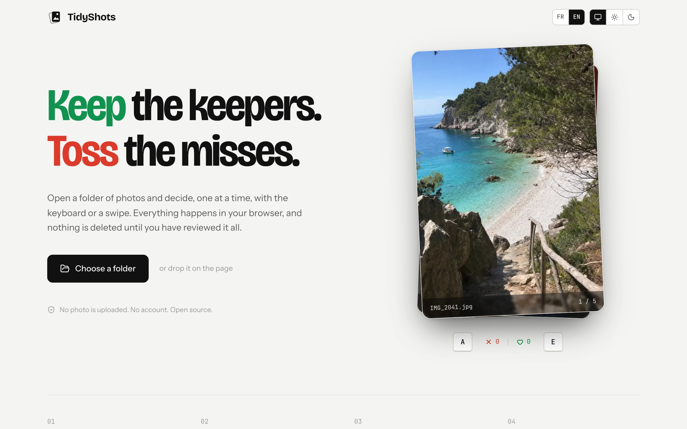
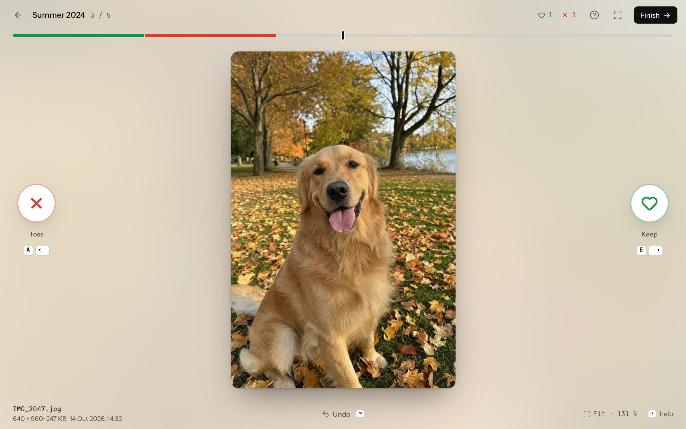
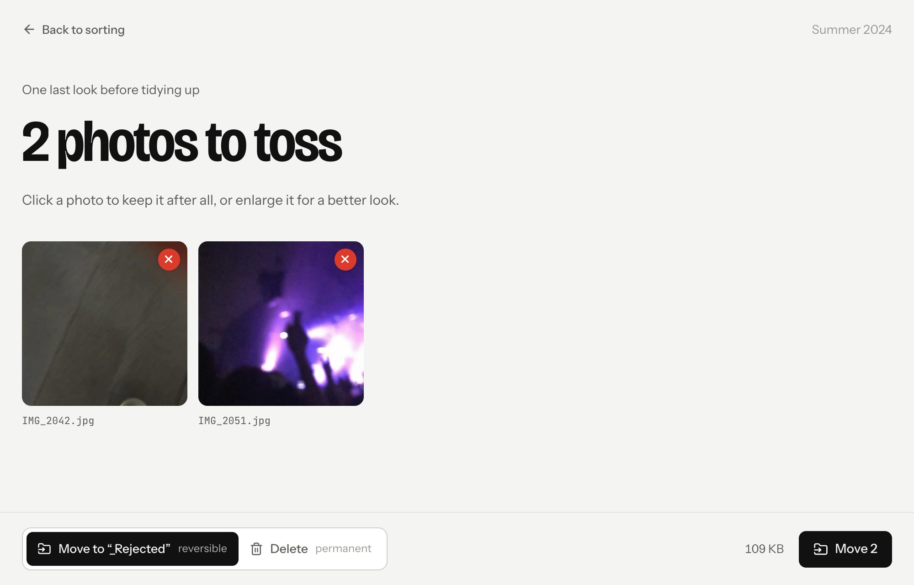

<div align="center">
  
  <h1>TidyShots</h1>
  <p><strong>Sort a folder of photos in your browser, one swipe at a time.</strong></p>
  <p>
    <a href="LICENSE"></a>
    
    
  </p>
</div>

<p align="center">
  <picture>
    <source media="(prefers-color-scheme: dark)" srcset="docs/images/home-dark.jpg" />
    
  </picture>
</p>

Open a folder and TidyShots shows its photos one by one. Right to keep, left to toss, with the keyboard or a swipe.
Nothing moves while you sort: at the end you look over the tossed photos one last time, then they go to a `_Rejected`
folder, or are deleted if you prefer.

Everything happens in the browser. Photos are read in place and never uploaded: there is no server, no account and no
analytics. The interface speaks English and French.

## Contents

- [How it works](#how-it-works)
- [Shortcuts](#shortcuts)
- [What it does with your files](#what-it-does-with-your-files)
- [Browsers](#browsers)
- [Privacy](#privacy)
- [Development](#development)

## How it works

1. **Open a folder.** Click "Choose a folder", or drop one on the page. The browser asks for access to it.
2. **Sort.** Each photo is shown large, with its size, date and, when the file has them, its camera settings. Keep it,
   toss it, or undo the last decision. A progress bar shows every decision so far.
3. **Review, then apply.** The tossed photos come back as a grid. Click one to keep it after all, or enlarge it for a
   better look. Then choose how to put them aside and confirm.

<p align="center">
  <picture>
    <source media="(prefers-color-scheme: dark)" srcset="docs/images/sort-dark.jpg" />
    
  </picture>
</p>

<p align="center">
  <picture>
    <source media="(prefers-color-scheme: dark)" srcset="docs/images/review-dark.jpg" />
    
  </picture>
</p>

You can stop at any time. Progress is saved in the browser: open the same folder again, or pick it from "Pick up a
sort" on the home page, and sorting resumes at the photo you stopped on.

## Shortcuts

| Shortcut                                             | Action                                     |
| ---------------------------------------------------- | ------------------------------------------ |
| <kbd>E</kbd> or <kbd>→</kbd>                         | Keep                                       |
| <kbd>A</kbd> or <kbd>←</kbd>                         | Toss                                       |
| <kbd>⌫</kbd> or <kbd>⌘</kbd>/<kbd>Ctrl</kbd> <kbd>Z</kbd> | Undo the last decision                  |
| Mouse wheel                                          | Zoom under the pointer                     |
| Double-click or <kbd>1</kbd>                         | See the photo at 100%, or back             |
| <kbd>+</kbd> / <kbd>−</kbd>                          | Zoom in / out                              |
| <kbd>0</kbd>                                         | Fit to screen                              |
| <kbd>F</kbd>                                         | Full screen                                |
| <kbd>?</kbd>                                         | Show every shortcut                        |
| Drag                                                 | Right to keep, left to toss; pans when zoomed |

## What it does with your files

- **Which photos.** The photos directly in the chosen folder, in file name order. Subfolders are left out. JPEG, PNG,
  WebP, AVIF, GIF and BMP are shown; formats the browser cannot draw (HEIC, TIFF, raw files on their own) are counted
  as skipped.
- **Linked files.** Files that share a photo's name travel with it if you want: the raw negative (`IMG_0001.CR3` next
  to `IMG_0001.JPG`), sidecars (`.xmp`, `.aae`, `.thm`), the video half of a Live Photo (`.mov`) and a HEIC original.
- **Move or delete.** "Move" puts the tossed photos in a `_Rejected` folder (`_Rejetées` in French) inside the chosen
  folder, so nothing is lost: move them back to undo. "Delete" removes them for good, without going through the trash.
- **Safety.** Nothing changes in the folder before you confirm the review. A photo edited since the folder was opened
  is left alone, and a name already taken in `_Rejected` gets a number instead of being overwritten.

## Browsers

TidyShots needs the [File System Access API](https://developer.mozilla.org/docs/Web/API/File_System_API) to read and
move files in a folder. It works in **Chrome, Edge, Brave and Opera on a computer**. Safari, Firefox and phone
browsers do not offer it, so the home page says so instead of showing the folder button.

## Privacy

- **No upload.** Photos are opened as local `blob:` URLs. The Content Security Policy only allows the page to talk to
  its own origin, so nothing can be sent elsewhere, even by mistake. There are no analytics and no third-party
  requests: fonts are self-hosted.
- **What is stored.** To resume a sort, the browser keeps the decisions and the folder handle in IndexedDB, for the
  last six folders. Never the photos. "Forget this sort" on the home page deletes an entry.
- **Not indexed.** Every response carries `X-Robots-Tag: noindex` and the page has a matching robots meta tag, so a
  deployment stays out of search engines. Remove both in [`next.config.ts`](next.config.ts) and
  [`src/app/layout.tsx`](src/app/layout.tsx) if you want yours to be found.

## Development

Requires [Node.js](https://nodejs.org) 20.9 or newer.

```bash
npm install
npm run dev        # http://localhost:3000
```

| Script              | What it does                    |
| ------------------- | ------------------------------- |
| `npm run dev`       | Starts the development server   |
| `npm run build`     | Builds the production site      |
| `npm run typecheck` | Type-checks the project         |
| `npm run lint`      | Lints the code with ESLint      |
| `npm test`          | Runs the unit tests with Vitest |

Built with [Next.js](https://nextjs.org) 16, React 19 and the React Compiler, [Tailwind CSS](https://tailwindcss.com)
4, [Motion](https://motion.dev) for the animations and [exifr](https://github.com/MikeKovarik/exifr) for the camera
details. Everything runs in the browser; the server only sends static files.

```text
src/lib/fs.ts          Reads the folder, groups linked files, moves or deletes the tossed photos
src/lib/session.ts     Decisions, undo and progress
src/lib/persist.ts     Saved sorts in IndexedDB
src/lib/loader.ts      Decodes and preloads the next photos
src/components/        Home, sorting, review and done screens
```

### Deploying

On [Vercel](https://vercel.com), import the repository: there is nothing to configure and no environment variable.
Any host that runs Next.js works too.

## License

[MIT](LICENSE)
